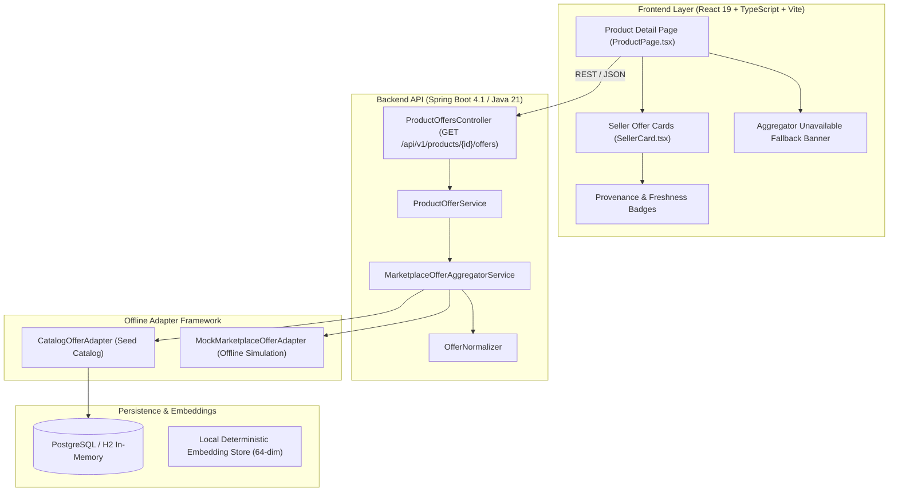

<div align="center">

<picture>
  <source srcset="docs/assets/banner.gif" type="image/gif">
  
</picture>

<p align="center">
  <strong>Intelligent Shopping, Grounded Evidence, Multi-Merchant Price Normalization.</strong><br/>
  <em>Understand true product prices. Compare multi-seller listings without hidden markups. Make informed purchase decisions.</em>
</p>

<p align="center">
  
  
  
  
  
  
  
  
</p>

<p align="center">
  <a href="#-project-overview"><strong>Overview</strong></a> &nbsp;&bull;&nbsp;
  <a href="#-architecture"><strong>Architecture</strong></a> &nbsp;&bull;&nbsp;
  <a href="#-marketplace-intelligence-subsystem-v13"><strong>Marketplace Pipeline</strong></a> &nbsp;&bull;&nbsp;
  <a href="#-quick-start--local-development"><strong>Quick Start</strong></a> &nbsp;&bull;&nbsp;
  <a href="#-audit--test-evidence"><strong>Test Evidence</strong></a> &nbsp;&bull;&nbsp;
  <a href="#-truthful-data--release-disclosure"><strong>Data Disclosure</strong></a> &nbsp;&bull;&nbsp;
  <a href="#-documentation-index"><strong>Documentation</strong></a>
</p>

</div>

---

> [!IMPORTANT]
> ### 🛡️ Truthful Data & Release Disclosure (v1.3)
> - **Current Implementation Scope**: PricePilot v1.3 is **complete with explicit exceptions for the agreed offline marketplace scope**.
> - **Data Provenance**: All marketplace listings, retailer prices, and seller records are served exclusively from **offline seed catalog fixtures** and **simulated demonstration adapters**.
> - **No Live Retailer Scraping**: No live external retail integrations, authorized partner feeds, or unauthorized web scraping mechanisms are connected or active.
> - **Simulated Offer Guardrails**: Simulated offers are explicitly labeled (`Simulated Offer`, `SIMULATED DEAL (TESTING)`). Neither simulated nor stale listings can claim an unqualified green `Best Deal` badge.
> - **Currency Conversion**: Real-time display conversion (USD, INR, EUR, GBP, JPY) applies client-side for buyer convenience; it is mathematical presentation and not a retailer-guaranteed final checkout price.
> - **Production Readiness**: Production deployment and live environment readiness have **not** been independently established.

---

## 🔍 Project Overview

PricePilot is an intelligent consumer shopping engine engineered to solve the core dilemmas of modern e-commerce: fragmented seller listings, opaque checkout fees, misleading discount claims, and unpredictable price trajectories.

Unlike traditional aggregator platforms that solely scrape numerical figures, PricePilot treats pricing data as **evidence**:
- **Normalized Multi-Seller Pricing**: Inspects base prices, separates unstated checkout fees, and attributes verified observation timestamps.
- **Evidence-Grounded Intelligence**: Rankings, discounts, and decision suggestions are computed deterministically on the backend rather than hallucinated by generative models.
- **Side-by-Side Spec Comparison**: Evaluates 2 to 5 candidate products across objective hardware, performance, and value metrics.
- **Deterministic Multi-Currency Engine**: Canonical persistence in USD guarantees ranking invariance across all supported buyer currencies.
- **Midnight Intelligence Design System**: Clean, futuristic dark and light themes crafted for high readability and responsive data density.

<br/>

<div align="center">
  
</div>

---

## 🏛️ Architecture

PricePilot is architected as a clean modular monolith combining a high-performance Java 21 backend with a React 19 SPA.



### Component Responsibilities

1. **`ProductOffersController`**: Exposes read-only REST endpoint `GET /api/v1/products/{id}/offers`, returning ranked, normalized seller offers.
2. **`ProductOfferService`**: Orchestrates offer queries, validates product existence, and handles 404 boundaries for unknown products.
3. **`MarketplaceOfferAggregatorService`**: Asynchronously coordinates offer collection across registered adapters with isolated fault tolerance.
4. **`OfferNormalizer`**: The single deterministic authority that standardizes raw seller inputs, evaluates freshness, validates currencies, and sorts canonical rankings.
5. **Adapters (`CatalogOfferAdapter`, `MockMarketplaceOfferAdapter`)**: Encapsulate distinct data sources entirely offline without leaking provider-specific quirks into the core domain.

---

## ⚡ Marketplace Intelligence Subsystem (v1.3)

The v1.3 release introduces a robust, resilient offline marketplace pipeline governed by strict integrity rules:

### 1. Data Contract & Fee Disclosure
- **Endpoint**: `GET /api/v1/products/{id}/offers`
- **Fee Separation**: Base prices are strictly separated from shipping, taxes, and merchant fees. If shipping fees are unstated by a source, they remain `null` and `basePriceOnly: true` is asserted. PricePilot **never infers missing fees as zero**.
- **Pricing Disclaimer**: All normalized offers deliver an explicit user-facing disclaimer: *"Listed base price. Additional shipping, taxes, and merchant fees may apply at checkout."*

### 2. Honest Provenance & Labeling
Every offer carries structured provenance metadata:
- **`DEMO` / `UNVERIFIED`**: Assigned to seed catalog listings (`trustLabel: "Catalog Offer"`).
- **`SIMULATED`**: Assigned to offline mock adapter listings (`trustLabel: "Simulated Offer"`).
- **`liveVerified: false`**: Strictly enforced across all v1.3 offline records.

### 3. Freshness Policy & The 168-Hour Boundary
- **Freshness Invariant**: Both backend and frontend enforce exact-duration calculations against observation timestamps.
- **Threshold**: An offer is marked stale (`isStale: true`) when its age is **strictly greater than 168 hours** (7 days). Offers at exactly 168 hours or below remain fresh.
- **Clock Skew Tolerance**: Future timestamps within 5 minutes ahead are tolerated as clock skew; observations $> 5$ minutes in the future are rejected as untrustworthy (`observedAt: null`, labeled `"Catalog Offer (Unverified Freshness)"`).
- **Missing Timestamps**: Offers lacking timestamps default to unverified freshness without crashing the pipeline.

### 4. Deterministic Ranking & Tie-Breaking
Offers for any given product are ranked using a mathematical three-tier invariant:
```text
1. Base Price (Canonical USD)       ──> ASCENDING   (Lowest price first)
2. Discount Percentage               ──> DESCENDING  (Highest saving first)
3. Seller Name                       ──> ASCENDING   (Lexicographic tie-breaker)
```
- **Currency Parity**: Only canonical USD offers participate in ranking; non-USD or undefined currencies are rejected without fabricated conversion rates.
- **Legitimate Zero Prices**: Explicit promotional base prices of $0.00 are validly ranked #1 without being dropped as invalid inputs.
- **Negative / Null Prices**: Strictly discarded during normalization.

### 5. Deal Claims & Visual Guardrails
- **Simulated Deals**: Labeled with amber badge `SIMULATED DEAL (TESTING)` and `Lowest simulated base price (Testing)`.
- **Stale Deals**: Stale offers with the lowest price receive an amber badge `Lowest Stale Listed Price`.
- **Green "Best Deal" Protection**: An unqualified green `Best Deal` badge is **strictly prohibited** on simulated, stale, or unverified-freshness offers.

### 6. Adapter Failure Isolation & Offline Fallback
- **Failure Resilience**: A failure or timeout thrown by an individual adapter is logged and isolated; surviving adapters still return valid offers.
- **Frontend Fallback**: If the aggregator endpoint fails entirely, the frontend falls back to standard catalog pricing and displays a prominent warning banner:
  > *Marketplace offer aggregator unavailable. Displaying catalog prices as fallback. [Catalog Fallback]*

---

## 🎨 Design System: Midnight Intelligence

PricePilot v1.3 features the **Midnight Intelligence** visual direction, harmonized across dark and light palettes:

| Design Token | Dark Theme (Default) | Light Theme | Usage |
| :--- | :--- | :--- | :--- |
| **Page Canvas** | `#111116` (Deep Midnight) | `#F6F6FA` (Soft Cloud) | Root document body background |
| **Card Surface** | `#202029` (Midnight Slate) | `#FFFFFF` (Pure White) | Interactive cards, modals, selectors |
| **Surface Accent** | `#282733` | `#ECE9FF` | Secondary buttons, hovered elements |
| **Primary Accent** | `#9585FF` (Cyber Iris) | `#6353D9` (Deep Iris) | Key CTAs, active indicators, focus rings |
| **Text Primary** | `#F6F5FA` | `#22222D` | Headings, primary pricing labels |
| **Text Secondary** | `#C7C5D2` | `#555565` | Descriptions, metadata, timestamps |
| **Subtle Border** | `#393946` | `#DCDCE5` | Card outlines, dividers, table headers |

---

## 🚀 Quick Start & Local Development

### Prerequisites
- **JDK 21 LTS** ([Eclipse Temurin](https://adoptium.net/) recommended)
- **Node.js 20+** and **npm**
- **Git**

### 1. Clone & Branch Verification
```bash
git clone https://github.com/jadhavaayush611/Price-Pilot.git
cd Price-Pilot
git checkout develop
```

### 2. Start the Backend API

#### Option A: In-Memory Offline Profile (Recommended for Demo & Quick Start)
Runs entirely without an external PostgreSQL database using H2 in-memory storage seeded with 252 products and local embeddings:
```bash
# Windows
.\mvnw.cmd spring-boot:run -Dspring-boot.run.profiles=local

# macOS / Linux
./mvnw spring-boot:run -Dspring-boot.run.profiles=local
```
*API boots at `http://localhost:8080/api/v1`.*

#### Option B: Development Profile (PostgreSQL + Flyway)
Requires PostgreSQL 15+ running on port `5432` with database `pricepilot`:
```bash
# Windows
.\mvnw.cmd spring-boot:run

# macOS / Linux
./mvnw spring-boot:run
```

### 3. Start the Frontend Application
```bash
cd frontend
npm install
npm run dev
```
*Web application launches at `http://localhost:5173/`.*

### 4. Verify Local Health
- Backend Health Probe: `http://localhost:8080/actuator/health`
- Product Listings: `http://localhost:8080/api/v1/products?page=0&size=5`
- Marketplace Offers Endpoint: `http://localhost:8080/api/v1/products/{id}/offers`

---

## 🧪 Audit & Test Evidence

Test verification summary reported from the **PricePilot v1.3 Completion Audit** (Commit `8cea31b`):

```text
========================================================================
PRICEPILOT v1.3 AUDIT SUMMARY
========================================================================
Backend Test Suite (Maven):       853 / 853 PASSED (0 failures, 0 errors)
Frontend Test Suite (Vitest):     256 / 256 PASSED (27 test files)
Ambient Component Tests:          32 / 32 PASSED
Focused Offer Normalizer Tests:   34 / 34 PASSED
Frontend Production Build:        COMPILED CLEANLY in 820ms (tsc -b && vite)
Browser End-to-End Smoke Tests:   10 / 10 FLOWS PASSED (Edge 155 via CDP)
========================================================================
```

### Test Execution Commands

```bash
# Run backend test suite (from repository root)
cd backend
.\mvnw.cmd test

# Run frontend test suite (from frontend directory)
cd frontend
npx vitest run

# Run focused marketplace offer normalizer tests
npx vitest run src/marketplace/offerNormalizer.test.ts

# Run production build validation
npm run build
```

### Known Quality Findings & Exceptions
- **ESLint Status**: 40 problems reported (34 errors, 6 warnings), comprising pre-existing `react-hooks/set-state-in-effect` patterns in dashboard/preferences pages and 3 marketplace lint items (two in integration tests, one in `ProductPage.tsx`).
- **Guest Comparison Endpoint**: Visiting `/compare` as a guest triggers an unauthenticated request to `/api/v1/compare/saved`, which returns an expected HTTP `401 Unauthorized` that is caught gracefully by the UI without breaking or crashing the view.

---

## 🗺️ Product Roadmap

```text
v1.0  ──  Core Price Tracking & Catalog Management           [COMPLETED]
          │
v1.1  ──  Multi-Seller Intelligence & Currency Subsystem      [COMPLETED]
          │
v1.2  ──  AI Shopping Companion & Semantic Decision Vectors  [COMPLETED]
          │
v1.3  ──  Offline Marketplace Pipeline & Design System        [CURRENT RELEASE]
          │
v1.4  ──  Predictive Price Analytics & Seasonal Forecasts     [PLANNED]
          │
v2.0  ──  Autonomous Live Retailer Partner Network            [FUTURE]
```

### v1.3 Implementation vs. Future Live Integration
- [x] **v1.3 Scope (Completed)**: Offline normalized offer pipeline, deterministic ranking invariants, 168h freshness boundary, honest provenance labeling, adapter fault isolation, responsive Midnight Intelligence UI.
- [ ] **Live Integration (Future)**: Partner retail API credential contracts, bounded timeout configurations, remote rate-limiting and circuit breakers, authorized live product catalog matching.
- [ ] **Production Infrastructure**: Staging environment verification, multi-region database migration rehearsals.

---

## 📚 Documentation Index

| Guide | Description |
| :--- | :--- |
| **[Backend Documentation](backend/README.md)** | Spring Boot architecture, marketplace service internals, REST endpoints, and adapter extension guide. |
| **[Frontend Documentation](frontend/README.md)** | React component structure, Midnight Intelligence tokens, offer consumption, and responsive behavior. |
| **[Local Installation Guide](docs/INSTALLATION.md)** | In-depth development prerequisites and environment configurations. |
| **[System Architecture](docs/ARCHITECTURE.md)** | End-to-end monolith design and state management principles. |
| **[Semantic Intelligence Spec](docs/SEMANTIC_INTELLIGENCE_ARCHITECTURE.md)** | Local deterministic 64-dimensional vector embedding architecture. |
| **[Marketplace Scope & Acceptance](docs/v1.3-scope-and-acceptance.md)** | Formal v1.3 delivery criteria and data integrity constraints. |
| **[Static Vector Banner](docs/assets/banner.svg)** | Scalable static SVG fallback banner asset for offline/vector rendering. |

---

## 📄 License & Community

PricePilot is open-source software licensed under the **[MIT License](LICENSE)**.
Contributions, bug reports, and architectural proposals are welcome via the [Contributing Guidelines](CONTRIBUTING.md).